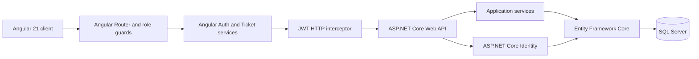
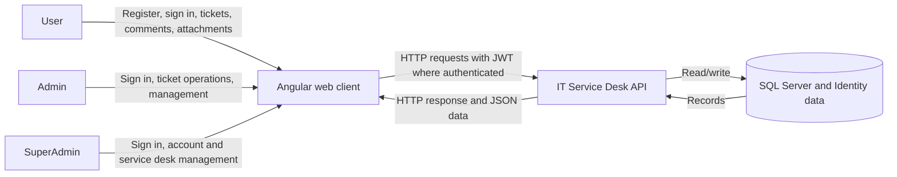
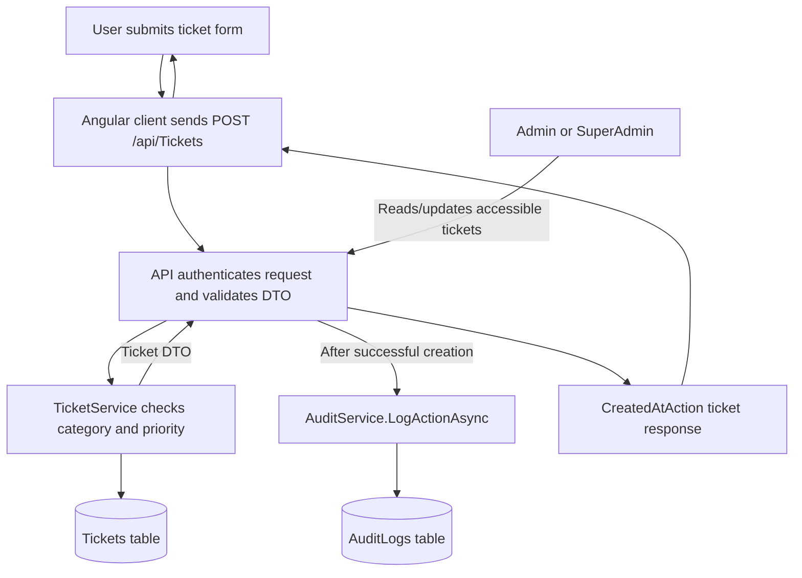
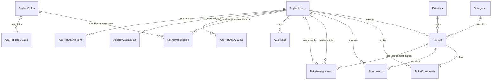

# IT Service Desk and Ticket Management System

## Capstone Project Report

> **Source review note:** This report describes behavior visible in the checked-in source. It does not certify that the application is deployed or that every feature has been exercised against a running database. No standalone "Capstone Project Titles" requirements document was found in the repository during this review. The project title and requested report sections are used here.

## Abstract

The IT Service Desk and Ticket Management System is a web application for submitting, tracking, and administering IT support requests. Its Angular client communicates with an ASP.NET Core Web API. The API uses ASP.NET Core Identity for accounts and roles, JSON Web Tokens (JWT) for authenticated requests, and Entity Framework Core with SQL Server for persistence. Tickets are related to categories, priorities, comments, attachments, and assignment history. The application defines three roles: User, Admin, and SuperAdmin. Public registration creates User accounts, while privileged accounts are provisioned by the API's configured seed process.

This report documents the architecture, data model, routes, validations, and tests that can be verified in the source. Deployment environment, production readiness, and real operational outcomes are not established by source inspection and are marked unverified.

## 1. Introduction

IT support requests need a consistent way to capture an issue, identify its owner and urgency, and record work performed. This project provides a ticket workflow with role-based screens for requesters and service desk administrators. Users submit requests and review tickets associated with their account. Admins manage tickets and service desk data. SuperAdmins have company-level account and service desk access.

The solution is split into three .NET projects and one Angular client:

- `ITServiceDesk.API`: ASP.NET Core endpoints, Identity/JWT configuration, persistence setup, and service registration.
- `ITServiceDesk.Core`: ticket and supporting domain entities.
- `ITServiceDesk.Tests`: xUnit unit tests, predominantly using EF Core's in-memory provider.
- `ITServiceDesk.Client`: Angular standalone components, routes, services, and the user interface.

## 2. Problem Statement

Without a shared support workflow, requests can be difficult to organize, prioritize, assign, and follow through to resolution. The application addresses this by storing tickets with status, category, priority, ownership, and timestamps, and by providing authenticated endpoints and role-specific access to ticket and management operations.

This is the problem addressed by the implementation; the repository does not provide measured evidence about a specific organization's prior support process or the system's operational impact.

## 3. Objectives and Scope

### 3.1 Objectives verified in source

- Allow a public visitor to register a normal User account and authenticate through a common login endpoint.
- Issue JWTs containing the authenticated account identity and role claims.
- Let Users create tickets and view their own tickets, including ticket details. The API also provides authorized comment and attachment operations, but those controls are currently exposed in the Admin ticket page rather than the User dashboard.
- Let Admins and SuperAdmins view and manage tickets according to endpoint authorization and ownership rules.
- Support ticket categorization, priorities, assignment records, reporting statistics, and audit log records.
- Provide role-protected Angular dashboards and management pages.
- Seed the three application roles and optionally provision Admin and SuperAdmin accounts from configuration.

### 3.2 Scope

The source includes ticket creation, listing, searching, pagination, editing, status updates, deletion, comments, attachments, assignments, categories, priorities, account role management, dashboard statistics, and audit log retrieval. The API supports comment and attachment operations for accessible tickets. In the Angular client, these controls are in the Admin ticket page; the User dashboard currently exposes ticket detail viewing only. `EmailService` uses `System.Net.Mail.SmtpClient` and reads the `EmailSettings` configuration keys. It is called by ticket assignment handling, enables SSL, and logs then swallows incomplete-configuration or sending failures, so assignment does not fail solely because email sending fails. Actual SMTP delivery has not been runtime verified.

No source evidence establishes integrations with external identity providers, a public deployment, service-level targets, or a production support organization.

## 4. Technology Stack and System Requirements

| Area | Verified technology |
|---|---|
| Backend | ASP.NET Core Web API, target framework `net10.0` |
| Authentication | ASP.NET Core Identity and JWT Bearer authentication |
| Data access | Entity Framework Core 10 SQL Server provider |
| Database | SQL Server, configured through the `DefaultConnection` connection-string key |
| Frontend | Angular 21 standalone application and TypeScript 5.9 |
| Frontend HTTP | Angular `HttpClient`, functional interceptor, RxJS |
| UI | Bootstrap 5.3 and project-specific component styles |
| API documentation | Swagger/OpenAPI configured in Development |
| Logging | Serilog console and rolling file sinks |
| Tests | xUnit, Moq, EF Core InMemory provider |
| Declared package manager | npm 11.8.0 in `package.json` |

### System requirements

The backend requires a .NET 10 compatible runtime/SDK for execution/build, and an accessible SQL Server instance with a valid `DefaultConnection`. The frontend dependencies require a compatible Node.js/npm environment; the exact supported Node.js version is not declared in the inspected project files. Angular's development origin is configured as `http://localhost:4200`, and the client service URLs reference `http://localhost:5204`.

Minimum CPU, RAM, operating system, browser versions, production hosting topology, TLS certificate configuration, and production database sizing are **not specified in the inspected source**.

## 5. Methodology and System Architecture

### 5.1 Methodology

The source contains a layered implementation: controllers handle HTTP and authorization, services contain data operations and domain workflow, EF Core maps entities, and Angular services/components implement client interaction. A project lifecycle methodology (for example, Agile, Waterfall, or a formal SDLC) is **not documented in the repository** and cannot be verified from the implementation alone.

### 5.2 Architecture



`Program.cs` registers the API services, Identity stores, SQL Server context, JWT validation, authorization, CORS, Swagger, and middleware. Controllers receive services through dependency injection. The Angular `authInterceptor` reads the token from browser local storage and adds `Authorization: Bearer <token>` when present.

The API applies HTTPS redirection and configures CORS for the Angular development origin `http://localhost:4200`. The Angular services currently use explicit `http://localhost:5204` URLs; production URL configuration is not demonstrated.

## 6. Data Flow Diagrams

### 6.1 Context-level DFD



### 6.2 Ticket submission and handling DFD



The diagrams represent the verified source flow. They do not represent external deployment infrastructure or unverified runtime services.

## 7. Database Design and Relationships

`ApplicationDbContext` derives from `IdentityDbContext<IdentityUser, IdentityRole, string>` and declares sets for tickets, categories, priorities, comments, attachments, audit logs, and ticket assignments. The EF Core migration and model snapshot define 14 tables: seven application tables and seven ASP.NET Identity tables. Identity supplies the account, role, membership, claim, login, and token tables. The project contains EF Core migrations and a model snapshot; migrations are not run as part of this documentation task.

### 7.1 Main entities

| Entity | Important fields verified in model |
|---|---|
| `Ticket` | `Id`, `Title`, `Description`, `Status`, `CreatedAt`, nullable `UpdatedAt`, `CategoryId`, `PriorityId`, `CreatedByUserId` |
| `Category` | `Id`, `Name`, nullable `Description`, `IsActive` |
| `Priority` | `Id`, `Name`, nullable `Description`, `IsActive` |
| `TicketComment` | `Id`, `Comment`, `CreatedAt`, `TicketId`, `UserId` |
| `Attachment` | `Id`, `FileName`, `FilePath`, `ContentType`, `UploadedAt`, `TicketId`, `UploadedByUserId` |
| `TicketAssignment` | `Id`, `TicketId`, `AssignedToUserId`, `AssignedByUserId`, `AssignedAt`, nullable `UnassignedAt` |
| `AuditLog` | `Id`, `Action`, `Details`, `CreatedAt`, `UserId` |
| Identity account/role | Managed by ASP.NET Core Identity; account IDs are strings. The source does not define a separate custom User model. |

The 14 physical tables in the EF Core model are:

- **Application (7):** `Tickets`, `Categories`, `Priorities`, `TicketComments`, `Attachments`, `AuditLogs`, `TicketAssignments`.
- **ASP.NET Identity (7):** `AspNetUsers`, `AspNetRoles`, `AspNetRoleClaims`, `AspNetUserClaims`, `AspNetUserLogins`, `AspNetUserRoles`, `AspNetUserTokens`.

### 7.2 Entity relationship diagram



`AspNetUserRoles` is the join table for the many-to-many relationship between `AspNetUsers` and `AspNetRoles`. The other Identity relationships shown are one-to-many from the owning user or role to its claims, logins, or tokens. The diagram intentionally omits column lists for the Identity tables; their physical table names and relationships are taken from the EF Core model snapshot and migrations.

EF Core configures restrictive deletes for ticket category, priority, creator, and user references. Deleting a ticket cascades to its comments, attachments, and assignments. Category deletion in the service deactivates the category instead of removing its row. The model configures maximum lengths for ticket title (200), category name (100), priority name (50), and comment (2000); DTO validation further constrains request values.

Default categories seeded in the model are Hardware, Software, Network, Account, and Other. Default priorities are Low, Medium, High, and Critical. Role names created by startup are SuperAdmin, Admin, and User.

## 8. User and Role Modules

### 8.1 User module

- Register with full name, email, and password.
- Log in through the shared login form.
- Create tickets and view tickets filtered to the authenticated user by the API.
- Review ticket status, category, priority, and creation date in the User dashboard.
- View ticket details from the User dashboard. Comment and attachment API operations are authorized for accessible tickets, but the corresponding comment and attachment interface is currently available in the Admin ticket page, not the User dashboard.
- Log out by clearing browser local storage and navigating to Login.

The User dashboard calls `GET /api/Tickets`; the controller passes the authenticated user ID and a non-admin access flag to `TicketService`, which scopes results to that user. The dashboard exposes ticket detail viewing. The dashboard's "My Tickets"/all tickets view is the same User dashboard component with route data controlling its view. Although the API provides comment and attachment endpoints that check ticket access, the Angular comment and attachment workflow is currently in the Admin ticket page, not the User dashboard.

### 8.2 Admin module

- Dashboard cards show ticket counts and latest ticket information using existing API services.
- View/search/paginate tickets, edit allowed ticket details, update status, and delete tickets subject to API rules.
- Create tickets through the shared ticket creation component.
- Assign tickets and mark assignments unassigned.
- View category and priority options; create, edit, and deactivate categories.
- View reports and category statistics.
- View audit logs.
- Manage normal User accounts; the API filters the Admin account list to accounts with the User role and only permits Admin to assign the User role.

Assignment endpoints are restricted to Admin by controller authorization. The SuperAdmin role is not included in `AssignmentsController` authorization in the inspected source.

### 8.3 SuperAdmin module

- Company-level dashboard combines account counts from `GET /api/Auth/users` with ticket statistics from `GET /api/Admin/dashboard`.
- User Management lists accounts returned by the account endpoint and supports permitted role changes.
- Accesses existing ticket, report, category, and audit pages through shared Admin route components and backend permissions.
- Can manage Admin and User roles through the account role endpoint, but the API explicitly disallows assigning the SuperAdmin role and prevents changes to a SuperAdmin account.

## 9. Authentication and Authorization

### 9.1 Registration and account provisioning

`POST /api/Auth/register` accepts `RegisterDto` (`FullName`, `Email`, `Password`). DTO rules require full name length 2-100, a syntactically valid email, and password length 8-100. The controller trims the submitted email, blocks the fixed demo addresses and any configured Admin/SuperAdmin seed addresses case-insensitively, checks for an existing email, creates the account with ASP.NET Core Identity, and assigns the `User` role. The endpoint does not accept a role from the public registration request.

Startup creates missing application roles. Admin and SuperAdmin credentials are read by configuration keys from User Secrets or other configuration providers; secret values are not included in this report. Seeding is optional when a credential pair is absent. A new configured account is created with the intended role; an existing account missing its intended role causes startup to require manual verification/provisioning rather than silently promoting it. Existing passwords are not reset by role seeding.

### 9.2 Login and JWT

`POST /api/Auth/login` accepts `LoginDto` (`Email`, `Password`). The controller finds the account by email and checks the password through `SignInManager`. Unknown account and incorrect password both return HTTP 401 with the same "Invalid email or password." message. Roles and the account's `FullName` claim are retrieved. A JWT is issued with:

- `ClaimTypes.NameIdentifier` (account ID)
- `ClaimTypes.Email`
- `ClaimTypes.Name` (full name)
- One `ClaimTypes.Role` claim per assigned role

The response DTO contains `Token`, `Email`, `FullName`, `Roles`, and `ExpiresAt`. The Angular Auth service stores these values in local storage. The API validates token signature, issuer, audience, and lifetime; clock skew is configured as zero. The Angular interceptor sends the bearer token when one is present.

### 9.3 Role authorization

The API uses `[Authorize]` to require an authenticated token and `[Authorize(Roles = "...")]` to require one of the listed roles. The Angular `roleGuard` checks locally stored roles for client navigation and redirects unauthenticated users to `/login`; unauthorized users are redirected to their own role dashboard. This client-side role data is used for navigation only and can be changed in the browser; it is not a security boundary. Backend JWT validation and `[Authorize]` role policies are the security boundary for API access.

`dashboardRedirectGuard` directs a signed-in user to the role dashboard in precedence order SuperAdmin, Admin, User. This is client-side navigation logic; backend `[Authorize]` policies independently protect data and operations.

## 10. Features, Workflows, and API Endpoints

All paths below derive from controller route attributes. Unless noted, endpoints are under `/api`. The API controllers use `[ApiController]`, so model validation failures are handled by ASP.NET Core's API behavior. Authorization shown here is based on the controller and action attributes.

### 10.1 Authentication and accounts - `AuthController`

| Method and path | Purpose | Access |
|---|---|---|
| `POST /api/Auth/register` | Register a normal User | Anonymous; reserved Admin/SuperAdmin emails rejected |
| `POST /api/Auth/login` | Authenticate and issue JWT | Anonymous |
| `GET /api/Auth/users` | List account summary data | Admin or SuperAdmin; Admin response is limited to normal Users |
| `PUT /api/Auth/users/{userId}/role` | Change role between User and Admin subject to safeguards | Admin or SuperAdmin; Admin may only assign User; SuperAdmin role cannot be assigned through this endpoint |

The users response includes user ID, email, full name, role list, and email-confirmed state; it does not return password data.

### 10.2 Tickets - `TicketsController`

| Method and path | Purpose | Access |
|---|---|---|
| `GET /api/Tickets` | List tickets; service scopes User results to current account | Authenticated |
| `GET /api/Tickets/my` | Ticket list method using the current account ID | Admin only; service is called with non-admin scope |
| `GET /api/Tickets/search` | Search/filter by search text, status, category, priority, sorting | Authenticated; service applies account scope for non-admin roles |
| `GET /api/Tickets/paginated` | Paginated ticket list (`pageNumber`, `pageSize`) | Authenticated; service applies account scope for non-admin roles |
| `GET /api/Tickets/{id}` | Get one accessible ticket | Authenticated; service checks access scope |
| `POST /api/Tickets` | Create ticket for current account | Authenticated |
| `PUT /api/Tickets/{id}` | Update ticket fields; User status is not changed by service, Admin/SuperAdmin can update it | Authenticated; owner check for User, broad access flag for Admin/SuperAdmin |
| `PATCH /api/Tickets/{id}/status` | Update ticket status | Admin or SuperAdmin |
| `DELETE /api/Tickets/{id}` | Delete ticket under service access rules | Authenticated; owner check for User, broad access flag for Admin/SuperAdmin |

Ticket creation validates title (5-200 characters), description (10-2000), positive category and priority IDs. Permitted status strings are `Open`, `In Progress`, `Resolved`, and `Closed`.

### 10.3 Dashboard and reports - `AdminController`

| Method and path | Purpose | Access |
|---|---|---|
| `GET /api/Admin/dashboard` | Total, Open, In Progress, Resolved, and Closed ticket counts | Admin or SuperAdmin |
| `GET /api/Admin/category-stats` | Ticket counts grouped by category | Admin or SuperAdmin |

The Admin dashboard also requests ticket data through the ticket endpoints. The frontend reports page computes display data from ticket service results; no separate report-generation endpoint is declared in the inspected controller.

### 10.4 Categories and priorities

| Method and path | Purpose | Access |
|---|---|---|
| `GET /api/Categories`, `GET /api/Categories/{id}` | Read categories | Authenticated |
| `POST /api/Categories`, `PUT /api/Categories/{id}`, `DELETE /api/Categories/{id}` | Create, update, deactivate category | Admin or SuperAdmin |
| `GET /api/Priorities`, `GET /api/Priorities/{id}` | Read priorities | Authenticated |

Category names are required and constrained to 2-100 characters; descriptions are at most 500 characters. Category deletion deactivates rather than physically deletes. Priorities are seeded in the model; no priority mutation endpoint appears in the inspected controller.

### 10.5 Comments, attachments, assignments, and audit logs

| Method and path | Purpose | Access |
|---|---|---|
| `GET /api/tickets/{ticketId}/comments` | Read comments on an accessible ticket | Authenticated; ticket access checked |
| `POST /api/tickets/{ticketId}/comments` | Add a comment as the current account | Authenticated; ticket access checked |
| `GET /api/tickets/{ticketId}/attachments` | List attachments on an accessible ticket | Authenticated; ticket access checked |
| `POST /api/tickets/{ticketId}/attachments` | Upload file to accessible ticket | Authenticated; ticket access checked; controller request limit 6 MB; service limit 5 MB and extension allowlist |
| `GET /api/tickets/{ticketId}/attachments/{attachmentId}/download` | Download attachment for accessible ticket | Authenticated; ticket access checked |
| `POST /api/Assignments` | Assign a ticket | Admin only |
| `GET /api/Assignments` | List assignments | Admin only |
| `PATCH /api/Assignments/{id}/unassign` | Mark assignment unassigned | Admin only |
| `GET /api/AuditLogs` | Read audit logs newest first | Admin or SuperAdmin |

Attachment extensions allowed by the service are `.jpg`, `.jpeg`, `.png`, `.pdf`, `.doc`, and `.docx`. Files are stored under the API `Uploads` directory using generated storage names. Download code checks the resolved path stays within the uploads root. Comment text is required and limited to 2-2000 characters.

These comment and attachment routes are API capabilities, not evidence of a User dashboard interface. The Angular client exposes their controls from the Admin ticket page; the User dashboard currently provides ticket detail viewing.

## 11. Validation and Error Handling

- Request DTOs use data annotations such as `[Required]`, `[EmailAddress]`, `[StringLength]`, `[Range]`, and `[RegularExpression]`.
- `TicketsController` and several other controllers convert service `ArgumentException`s into a 400 response with a message.
- Missing ticket/category resources generally return 404; duplicate category names return 409.
- Login uses the same 401 message for unknown email and incorrect password.
- Registration rejects reserved demo addresses with a generic safe message and existing accounts with an email-already-registered response.
- `GlobalExceptionMiddleware` logs unhandled exceptions with HTTP method and path and returns a generic HTTP 500 JSON message (`An unexpected server error occurred.`), rather than returning exception details.
- Angular login/register components contain client-side validations and display backend errors. Angular role guards support navigation UX; they do not replace API authorization.

Validation details not present in inspected DTOs or services should not be assumed. For example, this report does not claim a custom password complexity rule beyond the DTO minimum/maximum length and ASP.NET Identity configuration visible in source.

## 12. Testing

The repository includes an xUnit test project referencing the API and uses EF Core InMemory databases for service tests. Test files cover ticket service behavior, comments, attachments, assignments, audit logging, and selected Angular component/service/interceptor behavior. The ticket service tests include account scoping, Admin ticket access, update authorization, pagination, and search. The test project also references Moq for dependency mocks.

**Test execution result for this report:** tests were not run during documentation creation. No pass count or successful build is claimed here. A prior reported pass count, if any, is not independently verified by this documentation task.

## 13. Results and Screenshots

The source provides implementations for the roles, workflows, data model, API routes, and UI pages described in this report. Source inspection alone does not demonstrate runtime correctness, performance, user acceptance, or successful deployment.

Add genuine screenshots after capturing them from a running application. These are placeholders only; PNG files were not inspected, so screenshot availability and contents remain unverified.

### Screenshot 1 - Login page

`[Insert a genuine screenshot of the Login page here.]`

### Screenshot 2 - User dashboard and ticket list

`[Insert a genuine screenshot of the User dashboard here.]`

### Screenshot 3 - Admin dashboard and ticket management

`[Insert a genuine screenshot of the Admin dashboard here.]`

### Screenshot 4 - SuperAdmin dashboard and User Management

`[Insert a genuine screenshot of the SuperAdmin dashboard and account list here.]`

## 14. Limitations and Unverified Items

- Deployment URL, hosting provider, production configuration, and production database are not established by inspected source.
- The frontend's API URLs are localhost values; the production API URL and environment-based replacement strategy are not verified.
- The backend CORS origin inspected is localhost-based; production origins are not verified.
- Runtime delivery of email notifications depends on configuration and was not tested.
- No live database inspection, migration execution, browser session, or end-to-end testing was performed for this report.
- Minimum hardware specifications, supported browsers, backup policy, monitoring, and disaster recovery are not documented in the inspected project files.
- The source includes user and role management, but organization-specific provisioning procedures are not documented.
- PNG files are present in the checked-in upload directory, but their purpose and whether they are sample files have not been verified. This does not establish a production file-storage or retention policy.

## 15. Future Enhancements

The following are recommendations, not claims about existing features:

- Externalize API base URLs and CORS origins per environment before deployment.
- Add end-to-end tests for registration/login, role boundaries, and complete ticket workflows.
- Document deployment, backup, monitoring, and operational procedures.
- Establish a managed storage and retention policy for attachments.
- Add explicit service-level and performance measurements if required by the organization.
- Review authorization and account-provisioning behavior periodically as the role model evolves.

These suggestions do not imply that current source has been changed or that the enhancements are implemented.

## 16. Conclusion

The inspected source implements a role-based IT service desk with an Angular 21 client, ASP.NET Core 10 API, ASP.NET Core Identity, JWT bearer authentication, Entity Framework Core, and SQL Server. Its central workflow allows Users to create and track their own tickets while Admins and SuperAdmins access administrative service desk operations according to API authorization. Supporting records cover comments, attachments, assignments, categories, priorities, and audit events.

This report is a source-based description, not a deployment or runtime certification. Actual application behavior, deployment readiness, test execution results, and screenshot evidence should be confirmed in the target environment before final submission.

## End-to-End Flow Diagram

```mermaid
sequenceDiagram
    actor Person as User/Admin/SuperAdmin
    participant UI as Angular client
    participant Auth as AuthController / Identity
    participant API as Protected API controller
    participant Service as Application service
    participant DB as SQL Server

    Person->>UI: Register or enter login details
    alt Public registration
        UI->>Auth: POST /api/Auth/register
        Auth->>DB: Create Identity user and assign User role
        Auth-->>UI: Registration result; login is separate
    else Login
        UI->>Auth: POST /api/Auth/login
        Auth->>DB: Find account and verify password
        Auth-->>UI: JWT, email, name, roles, expiry
        UI->>UI: Store session data in local storage
    end
    UI->>API: Request with Authorization: Bearer JWT
    API->>API: Validate JWT and enforce role/ownership rules
    API->>Service: Execute requested workflow
    Service->>DB: Read or write authorized data
    DB-->>Service: Result
    Service-->>API: DTO/result
    API-->>UI: HTTP response
    UI-->>Person: Render dashboard or workflow result
    Person->>UI: Logout
    UI->>UI: Clear local storage and navigate to Login
```
